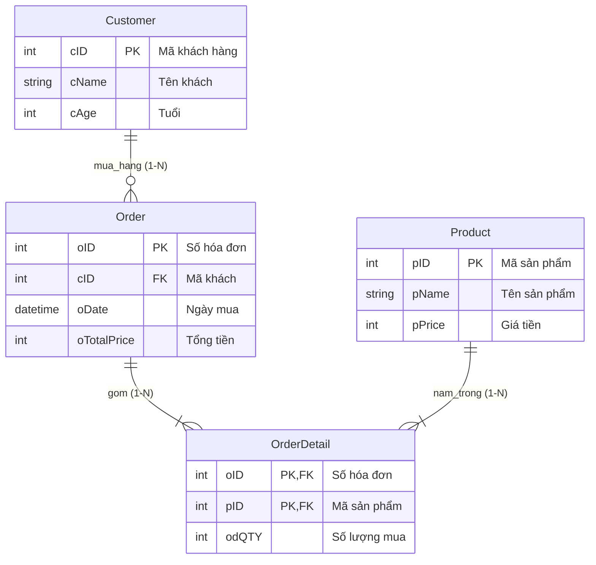

# [Bài tập/Thực hành] Xây dựng cơ sở dữ liệu Quản lý bán hàng (`QuanLyBanHang`)

## 🎯 Mục tiêu
- Tạo được cơ sở dữ liệu và các bảng dữ liệu bằng câu lệnh SQL DDL trên MySQL.
- Nắm vững cú pháp thiết lập các **ràng buộc toàn vẹn (Constraints)**:
  - Khóa chính đơn (`PRIMARY KEY`) và Khóa chính phức hợp (`PRIMARY KEY (oID, pID)`).
  - Khóa ngoại (`FOREIGN KEY ... REFERENCES ...`) với cơ chế `ON UPDATE CASCADE`, `ON DELETE CASCADE / RESTRICT`.
  - Ràng buộc kiểm tra (`CHECK`) và giá trị mặc định (`DEFAULT`).
- Xử lý được các từ khóa dành riêng của MySQL (như tên bảng `` `Order` `` phải đặt trong cặp dấu backtick).

---

## 📋 Mô tả nghiệp vụ & Cấu trúc các bảng

Hệ thống quản lý bán hàng của siêu thị / cửa hàng gồm 4 bảng:

### 1. Bảng `Customer` (Khách hàng)
Lưu trữ danh sách khách hàng (bao gồm cả khách hàng đã mua và khách vãng lai chưa phát sinh đơn):
| Tên cột | Kiểu dữ liệu | Ràng buộc | Mô tả |
|---|---|---|---|
| `cID` | INT | **PRIMARY KEY**, AUTO_INCREMENT | Mã định danh khách hàng |
| `cName` | VARCHAR(25) | NOT NULL | Tên khách hàng |
| `cAge` | TINYINT | CHECK (`cAge` > 0) | Tuổi khách hàng |

### 2. Bảng `Order` (Hóa đơn mua hàng)
Lưu thông tin các hóa đơn mua hàng được siêu thị xuất cho khách:
| Tên cột | Kiểu dữ liệu | Ràng buộc | Mô tả |
|---|---|---|---|
| `oID` | INT | **PRIMARY KEY**, AUTO_INCREMENT | Số hóa đơn / Mã đơn hàng |
| `cID` | INT | **FOREIGN KEY** &rarr; `Customer(cID)` | Mã khách hàng mua hàng |
| `oDate` | DATETIME | NOT NULL | Ngày và giờ lập hóa đơn |
| `oTotalPrice` | INT / DECIMAL(15,2) | NULL | Tổng số tiền của hóa đơn |

> ⚠️ **LƯU Ý QUAN TRỌNG:** Trong MySQL, từ `ORDER` là từ khóa dành riêng trong mệnh đề sắp xếp (`ORDER BY`). Do đó khi đặt tên bảng là `Order`, bạn **bắt buộc phải bọc trong cặp dấu backtick** `` `Order` `` để tránh lỗi cú pháp.

### 3. Bảng `Product` (Sản phẩm)
Lưu trữ danh mục các mặt hàng được bày bán trong cửa hàng:
| Tên cột | Kiểu dữ liệu | Ràng buộc | Mô tả |
|---|---|---|---|
| `pID` | INT | **PRIMARY KEY**, AUTO_INCREMENT | Mã sản phẩm |
| `pName` | VARCHAR(25) | NOT NULL | Tên sản phẩm |
| `pPrice` | INT | NOT NULL, CHECK (`pPrice` >= 0) | Đơn giá sản phẩm |

### 4. Bảng `OrderDetail` (Chi tiết hóa đơn)
Bảng trung gian giải quyết quan hệ Nhiều - Nhiều (`N - N`) giữa hóa đơn (`Order`) và sản phẩm (`Product`):
| Tên cột | Kiểu dữ liệu | Ràng buộc | Mô tả |
|---|---|---|---|
| `oID` | INT | **PK, FK** &rarr; `` `Order`(oID) `` | Mã hóa đơn |
| `pID` | INT | **PK, FK** &rarr; `Product(pID)` | Mã sản phẩm mua |
| `odQTY` | INT | NOT NULL, CHECK (`odQTY` > 0) | Số lượng mua của mặt hàng |

---

## 🛠 Kịch bản câu lệnh SQL tạo CSDL và các bảng

```sql
-- 1. Tạo cơ sở dữ liệu QuanLyBanHang
CREATE DATABASE IF NOT EXISTS QuanLyBanHang
    CHARACTER SET utf8mb4
    COLLATE utf8mb4_unicode_ci;

USE QuanLyBanHang;

-- 2. Tạo bảng Customer
CREATE TABLE IF NOT EXISTS Customer (
    cID INT AUTO_INCREMENT PRIMARY KEY,
    cName VARCHAR(25) NOT NULL,
    cAge TINYINT CHECK (cAge > 0)
) ENGINE=InnoDB DEFAULT CHARSET=utf8mb4 COLLATE=utf8mb4_unicode_ci;

-- 3. Tạo bảng Order (chú ý cặp dấu backtick quanh chữ Order)
CREATE TABLE IF NOT EXISTS `Order` (
    oID INT AUTO_INCREMENT PRIMARY KEY,
    cID INT NOT NULL,
    oDate DATETIME NOT NULL,
    oTotalPrice INT NULL,
    CONSTRAINT fk_order_customer FOREIGN KEY (cID) 
        REFERENCES Customer(cID) ON UPDATE CASCADE ON DELETE RESTRICT
) ENGINE=InnoDB DEFAULT CHARSET=utf8mb4 COLLATE=utf8mb4_unicode_ci;

-- 4. Tạo bảng Product
CREATE TABLE IF NOT EXISTS Product (
    pID INT AUTO_INCREMENT PRIMARY KEY,
    pName VARCHAR(25) NOT NULL,
    pPrice INT NOT NULL CHECK (pPrice >= 0)
) ENGINE=InnoDB DEFAULT CHARSET=utf8mb4 COLLATE=utf8mb4_unicode_ci;

-- 5. Tạo bảng OrderDetail (Khóa chính phức hợp & 2 khóa ngoại)
CREATE TABLE IF NOT EXISTS OrderDetail (
    oID INT NOT NULL,
    pID INT NOT NULL,
    odQTY INT NOT NULL CHECK (odQTY > 0),
    PRIMARY KEY (oID, pID),
    CONSTRAINT fk_od_order FOREIGN KEY (oID) 
        REFERENCES `Order`(oID) ON UPDATE CASCADE ON DELETE CASCADE,
    CONSTRAINT fk_od_product FOREIGN KEY (pID) 
        REFERENCES Product(pID) ON UPDATE CASCADE ON DELETE RESTRICT
) ENGINE=InnoDB DEFAULT CHARSET=utf8mb4 COLLATE=utf8mb4_unicode_ci;
```

---

## 📊 Sơ đồ quan hệ thực thể (ERD)



---

## 🧪 Dữ liệu thử nghiệm và 4 câu truy vấn nghiệp vụ kinh điển

```sql
-- Thêm khách hàng
INSERT INTO Customer (cID, cName, cAge) VALUES
(1, 'Minh Quan', 10),
(2, 'Ngoc Oanh', 20),
(3, 'Hong Ha', 50);

-- Thêm hóa đơn
INSERT INTO `Order` (oID, cID, oDate, oTotalPrice) VALUES
(1, 1, '2006-03-21', NULL),
(2, 2, '2006-03-23', NULL),
(3, 1, '2006-03-16', NULL);

-- Thêm sản phẩm
INSERT INTO Product (pID, pName, pPrice) VALUES
(1, 'May Giat', 3),
(2, 'Tu Lanh', 5),
(3, 'Dieu Hoa', 7),
(4, 'Quat', 1),
(5, 'Bep Dien', 2);

-- Thêm chi tiết hóa đơn
INSERT INTO OrderDetail (oID, pID, odQTY) VALUES
(1, 1, 3),
(1, 3, 7),
(1, 4, 2),
(2, 1, 1),
(3, 1, 8),
(2, 5, 4),
(2, 3, 3);

-- 1. Hiển thị danh sách hóa đơn (oID, oDate, oPrice)
SELECT oID, oDate, oTotalPrice FROM `Order`;

-- 2. Hiển thị danh sách khách hàng đã mua và danh sách sản phẩm được mua
SELECT 
    c.cName AS 'Tên khách hàng',
    p.pName AS 'Tên sản phẩm',
    od.odQTY AS 'Số lượng mua'
FROM Customer c
JOIN `Order` o ON c.cID = o.cID
JOIN OrderDetail od ON o.oID = od.oID
JOIN Product p ON od.pID = p.pID;

-- 3. Hiển thị những khách hàng KHÔNG mua bất kỳ sản phẩm nào
SELECT 
    c.cID,
    c.cName,
    c.cAge
FROM Customer c
LEFT JOIN `Order` o ON c.cID = o.cID
WHERE o.oID IS NULL;

-- 4. Tính tổng tiền cho từng hóa đơn (SUM(odQTY * pPrice))
SELECT 
    o.oID AS 'Số Hóa Đơn',
    o.oDate AS 'Ngày Mua',
    SUM(od.odQTY * p.pPrice) AS 'Tổng Giá Trị Hóa Đơn'
FROM `Order` o
JOIN OrderDetail od ON o.oID = od.oID
JOIN Product p ON od.pID = p.pID
GROUP BY o.oID, o.oDate;
```

---

## 📁 Cấu trúc thư mục dự án

```text
building-a-sales-management-database/
├── README.md               # Tài liệu phân tích nghiệp vụ, cấu trúc bảng & truy vấn
├── quan_ly_ban_hang.sql    # Kịch bản SQL đầy đủ (DDL, ràng buộc, dữ liệu mẫu, SELECT)
└── index.html              # Ứng dụng web trực quan hiển thị ERD và bảng tính hóa đơn
```

---

## 🚀 Đẩy mã nguồn lên GitHub Repository

```bash
cd C:\Users\ductr\.gemini\antigravity-ide\scratch\building-a-sales-management-database
git push -u origin main
```
